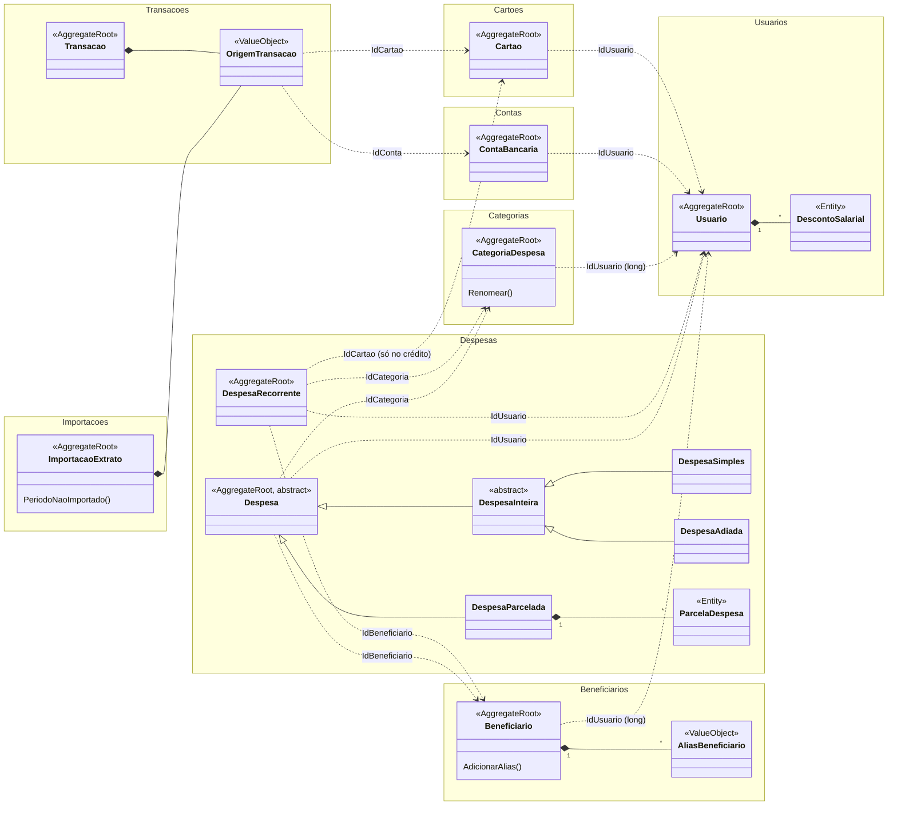
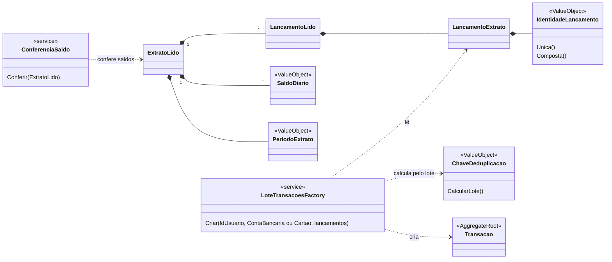

# Modelo de domínio

Retrato do `src/ControleFinanceiro.Domain`: agregados, entidades, value objects e como se referenciam. Mostra o que é estável (estrutura, relações, invariantes principais): as classes não listam propriedades, só os métodos que carregam regra de negócio. **Quem muda agregado, entidade, value object ou relação no Domain atualiza este arquivo no mesmo PR**; o `revisor-dominio` cobra.

Legenda:

- `<<AggregateRoot>>`: raiz de agregado, carregada e gravada inteira pelo seu repositório.
- `<<Entity>>`: entidade interna de um agregado, só alcançada pela raiz.
- `<<ValueObject>>` e `<<SmartEnum>>`: sem identidade, comparados pelo valor.
- `*--` composição (faz parte do agregado); `..>` referência por id a outro agregado; `--|>` herança.
- Ids são structs Vogen sobre `Guid` (`IdUsuario`, `IdDespesa`…), gerados com `FromNewVersion7Guid`.

Entre agregados, a referência é sempre pelo id da raiz: nenhum agregado guarda outro nem entidade de outro.

## Agregados

### Invariantes que valem saber

- **Usuario**: `RendaLiquida` = renda bruta − descontos.
- **Cartao**: um por banco + sufixo em cada usuário. Só nasce pela `CartaoFactory`, que recebe os cartões do usuário e falha com `ErroCartaoJaCadastrado`; o índice único da tabela é a rede para duas requisições ao mesmo tempo.
- **ContaBancaria**: uma por banco + sufixo em cada usuário, com o apelido padrão "&lt;tipo&gt; &lt;banco&gt; final &lt;sufixo&gt;". Só nasce pela `ContaBancariaFactory.ObterOuCriar`, que devolve a conta existente ou uma nova, e falha com `ErroContaDeOutroTipo` se a conta existe com outro tipo.
- **DespesaRecorrente**: cartão obrigatório no crédito e proibido nas outras formas. Só nasce pela `DespesaRecorrenteFactory`, que confere que o cartão é do próprio usuário.
- **Despesas**: `DespesaSimples` é paga na compra e não aceita crédito; `DespesaAdiada` é sempre crédito, com pagamento pendente no mês seguinte, no dia de vencimento do cartão; `DespesaParcelada` é sempre crédito, com uma `ParcelaDespesa` pendente por mês.
- **Transacao**: valor com sinal do ponto de vista do usuário (negativo é saída). Só nasce pela `LoteTransacoesFactory`, que confere que a conta ou o cartão é do usuário e garante a `ChaveDeduplicacao` do lote. A identidade é o `IdTransacao`; a chave só reconhece o lançamento numa reimportação.
- **OrigemTransacao**: conta ou cartão, nunca os dois.
- **ImportacaoExtrato**: `Novas` entre 0 e `Lidas`. `PeriodoNaoImportado` aponta o buraco entre a importação anterior da mesma origem e esta.

### Erros

Cada falha prevista que é uma situação de negócio com nome próprio é um tipo derivado do `Erro` abstrato, na pasta do seu agregado, com igualdade só pelo `Codigo`; quem chama decide pelo tipo, e o endpoint mapeia cada tipo para um status. Valor que não pertence ao conceito, como a validação de um value object, falha com mensagem em texto (`Result<T>`).

| Erro | Agregado | Quando |
|---|---|---|
| `ErroCartaoJaCadastrado` | `Cartoes` | O usuário já tem um cartão do banco com o mesmo final. |
| `ErroContaDeOutroTipo` | `Contas` | O usuário já tem a conta, mas de outro tipo. |
| `ErroOrigemNaoPertenceAoUsuario` | `Transacoes` | A conta ou o cartão do lote é de outro usuário. |
| `ErroIdentificadorRepetido` | `Transacoes` | Dois lançamentos do lote têm o mesmo id do banco. |

## Importação de um extrato

Objetos de leitura que não são gravados: o adaptador de cada layout produz o `ExtratoLido`, a `ConferenciaSaldo` o valida e a `LoteTransacoesFactory` o transforma em transações.

## Serviços de domínio

Estáticos e puros: recebem os agregados e as listas de que precisam, e quem chama os carrega pelos repositórios. Uma lista com item de outro usuário é erro de quem chama e lança `ArgumentException`.

| Serviço | O que faz |
|---|---|
| `CartaoFactory` | Cria o cartão do usuário, conferindo banco + sufixo entre os cartões dele. |
| `ContaBancariaFactory` | Acha a conta do extrato entre as do usuário, ou cria uma. |
| `DespesaRecorrenteFactory` | Cria a despesa recorrente, conferindo que o cartão é do usuário. |
| `GeracaoDespesasDoMesService` | Gera as despesas de um mês a partir das recorrentes: `DespesaSimples` com pagamento imediato, ou `DespesaAdiada` com pagamento no vencimento do cartão. |
| `LoteTransacoesFactory` | Confere que a origem é do usuário e que nenhum id de banco se repete no lote; calcula as chaves e cria as transações. |
| `ConferenciaSaldo` | Confere que os lançamentos de cada dia contábil levam o saldo do dia anterior ao saldo do dia. |

## Portas

| Porta | Agregado |
|---|---|
| `IUsuarioRepository` | `Usuario` |
| `ICartaoRepository` | `Cartao` (lista os do usuário) |
| `ITransacaoRepository` | `Transacao` (adiciona só as de chave nova) |
| `IImportacaoRepository` | `ImportacaoExtrato` |

O repositório da `ContaBancaria` chega com a persistência da importação (#47); o da `DespesaRecorrente`, com o cadastro das despesas fixas (#9).

## Value objects

Cada value object mora na pasta do agregado dono, mesmo quando outro agregado o usa:

- `Cartoes`: `SufixoCartao`, `DiaVencimentoCartao`.
- `Contas`: `SufixoConta` e o SmartEnum `TipoConta`.
- `Despesas`: `DiaCompraRecorrente`, `Pagamento` (valor, `StatusPagamento`, datas projetada e efetiva) e os SmartEnums `FormaPagamento` e `StatusPagamento`.
- `Importacoes`: `PeriodoExtrato`, `SaldoDiario` e o SmartEnum `FormatoExtrato`.
- `Transacoes`: `OrigemTransacao`, `IdentidadeLancamento`, `ChaveDeduplicacao`.

Em `Shared/ValueObjects` ficam só os conceitos sem dono: `Reais` (com sinal) e `ReaisPositivo` para dinheiro; `TextoObrigatorio`; `MesReferencia`, o calendário do balanço; `DiaValidoEmTodoMes`, a base dos dias de 1 a 28 que o `MesReferencia` aceita; e o SmartEnum `Banco` (código COMPE).
