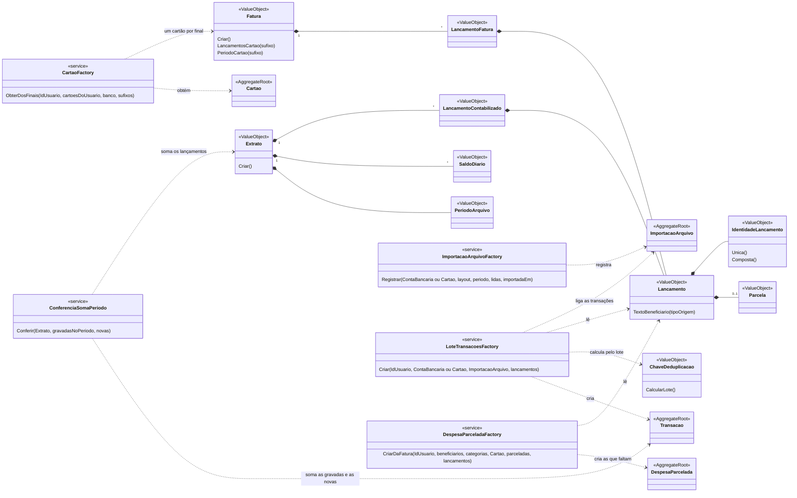

# Modelo de domínio

Retrato do `src/ControleFinanceiro.Domain`: agregados, entidades, value objects e como se referenciam. Mostra o que é estável (estrutura, relações, invariantes principais): as classes não listam propriedades, só os métodos que carregam regra de negócio. **Quem muda agregado, entidade, value object ou relação no Domain atualiza este arquivo no mesmo PR**; o `revisor-dominio` cobra.

Legenda:

- `<<AggregateRoot>>`: raiz de agregado, carregada e gravada inteira pelo seu repositório.
- `<<Entity>>`: entidade interna de um agregado, só alcançada pela raiz.
- `<<ValueObject>>` e `<<SmartEnum>>`: sem identidade, comparados pelo valor.
- `*--` composição (faz parte do agregado); `..>` referência por id a outro agregado; `--|>` herança.
- Ids são structs Vogen sobre `Guid` (`IdUsuario`, `IdDespesa`…), gerados com `FromNewVersion7Guid`.
- Todo agregado com `..> Usuario : IdUsuario` implementa `IPertenceAoUsuario` e é filtrado pelo usuário atual.

Entre agregados, a referência é sempre pelo id da raiz: nenhum agregado guarda outro nem entidade de outro.

## Agregados

```mermaid
classDiagram
    direction LR

    namespace Usuarios {
        class Usuario {
            <<AggregateRoot>>
        }
        class DescontoSalarial {
            <<Entity>>
        }
    }

    namespace Cartoes {
        class Cartao {
            <<AggregateRoot>>
            AlterarCicloFatura(DiaVencimentoCartao, DiaFechamentoCartao)
        }
    }

    namespace Contas {
        class ContaBancaria {
            <<AggregateRoot>>
        }
    }

    namespace Despesas {
        class DespesaRecorrente {
            <<AggregateRoot>>
            PossuiBeneficiarioEDescricao(IdBeneficiario, TextoObrigatorio)
        }
        class Despesa {
            <<AggregateRoot, abstract>>
            AlterarCategoria(IdCategoriaDespesa)
            DesfazerVinculo(IdTransacao)
        }
        class DespesaInteira {
            <<abstract>>
            QuitarCom(IdTransacao, dataEfetiva, valorEfetivo)
        }
        class DespesaSimples
        class DespesaAdiada
        class DespesaParcelada {
            Criar(IdUsuario, IdBeneficiario, descricao, IdCategoria, dataOcorrencia, valor, IdCartao, mesPrimeiraParcela, DiaVencimentoCartao, Parcela)
            ParcelaDoMes(MesReferencia)
            EhDaCompra(ChaveCompraParcelada)
            ParcelaNumero(numero)
            QuitarParcela(Parcela, IdTransacao, valorEfetivo)
        }
        class ParcelaDespesa {
            <<Entity>>
        }
        class ChaveCompraParcelada {
            <<ValueObject>>
            DaTransacao(Transacao)
        }
        class ParcelaDaCompra {
            <<ValueObject>>
            DaTransacao(Transacao)
        }
    }

    namespace Beneficiarios {
        class Beneficiario {
            <<AggregateRoot>>
            RemoverAlias(Alias)
            Renomear(TextoObrigatorio)
            PossuiAlias(Alias)
        }
        class AliasBeneficiario {
            <<ValueObject>>
        }
    }

    namespace Shared {
        class Alias {
            <<ValueObject>>
        }
    }

    namespace Categorias {
        class CategoriaDespesa {
            <<AggregateRoot>>
            RemoverAlias(Alias)
            PossuiAlias(Alias)
            PossuiNome(TextoObrigatorio)
            EhOutros
        }
        class AliasCategoria {
            <<ValueObject>>
        }
    }

    namespace Transacoes {
        class Transacao {
            <<AggregateRoot>>
        }
        class OrigemTransacao {
            <<ValueObject>>
        }
        class Parcela {
            <<ValueObject>>
        }
    }

    namespace Importacoes {
        class ImportacaoArquivo {
            <<AggregateRoot>>
            PeriodoNaoImportado()
        }
    }

    Usuario "1" *-- "*" DescontoSalarial
    Cartao ..> Usuario : IdUsuario
    ContaBancaria ..> Usuario : IdUsuario

    DespesaRecorrente ..> Usuario : IdUsuario
    DespesaRecorrente ..> Cartao : IdCartao (só no crédito)
    DespesaRecorrente ..> Beneficiario : IdBeneficiario
    DespesaRecorrente ..> CategoriaDespesa : IdCategoria

    Despesa <|-- DespesaInteira
    Despesa <|-- DespesaParcelada
    DespesaInteira <|-- DespesaSimples
    DespesaInteira <|-- DespesaAdiada
    DespesaParcelada "1" *-- "*" ParcelaDespesa
    Despesa ..> Usuario : IdUsuario
    Despesa ..> Beneficiario : IdBeneficiario
    Despesa ..> CategoriaDespesa : IdCategoria (opcional)
    Despesa ..> DespesaRecorrente : IdDespesaRecorrente (quando gerada por uma)
    DespesaAdiada ..> Cartao : IdCartao
    DespesaParcelada ..> Cartao : IdCartao
    DespesaParcelada ..> ChaveCompraParcelada : EhDaCompra
    ChaveCompraParcelada ..> Cartao : IdCartao
    ParcelaDaCompra *-- ChaveCompraParcelada
    ParcelaDaCompra ..> Transacao : DaTransacao
    ChaveCompraParcelada ..> Transacao : DaTransacao
    Despesa ..> Transacao : IdTransacao (no Pagamento, quando vinculada)

    Beneficiario "1" *-- "*" AliasBeneficiario
    AliasBeneficiario *-- Alias
    AliasBeneficiario ..> Usuario : IdUsuario
    Beneficiario ..> Usuario : IdUsuario
    CategoriaDespesa "1" *-- "*" AliasCategoria
    AliasCategoria *-- Alias
    AliasCategoria ..> Usuario : IdUsuario
    CategoriaDespesa ..> Usuario : IdUsuario

    Transacao *-- OrigemTransacao
    Transacao *-- "0..1" Parcela
    Transacao ..> Usuario : IdUsuario
    Transacao ..> ImportacaoArquivo : IdImportacao
    OrigemTransacao ..> ContaBancaria : IdConta
    OrigemTransacao ..> Cartao : IdCartao
    ImportacaoArquivo *-- OrigemTransacao
    ImportacaoArquivo ..> Usuario : IdUsuario
```

### Invariantes que valem saber

- **Usuario**: `RendaLiquida` = renda bruta − descontos.
- **Cartao**: um por banco + sufixo em cada usuário. Só nasce pela `CartaoFactory`, que recebe os cartões do usuário: o `Criar` falha com `ErroCartaoJaCadastrado`, e o `ObterDosFinais` devolve o cartão de cada final de uma fatura, ou falha com `ErroCartoesNaoResolvidos`: a importação nunca cria cartão. O índice único da tabela é a rede para duas requisições ao mesmo tempo. O dia de vencimento e o de fechamento são obrigatórios, sem regra entre eles. Os dois podem ser alterados depois, e os dias novos valem só para as despesas geradas a partir daí: as já geradas e as parcelas já criadas guardam a data projetada do pagamento.
- **ContaBancaria**: uma por banco + sufixo em cada usuário, com o apelido padrão "&lt;tipo&gt; &lt;banco&gt; final &lt;sufixo&gt;". Só nasce pela `ContaBancariaFactory.ObterOuCriar`, que devolve a conta existente ou uma nova, e falha com `ErroContaDeOutroTipo` se a conta existe com outro tipo.
- **Beneficiario**: quem recebeu o dinheiro de uma saída, reconhecido no arquivo só pelos aliases, nunca pelo nome. Pode nascer sem alias (cadastro manual, sem arquivo). Cada alias aponta para um beneficiário só em cada usuário: o beneficiário só nasce e só ganha alias pela `BeneficiarioFactory`, que recebe os beneficiários do usuário: o `Resolver` aplica um lote inteiro ou nada (`BeneficiarioNovo`, com ou sem alias, e `AliasBeneficiarioExistente`) e falha com `ErroAliasBeneficiarioJaAtribuido`. O nome não é único: o usuário o escolhe livremente. O índice único `(id_usuario, texto_normalizado)` é a rede, e por isso o `AliasBeneficiario` guarda o `IdUsuario`. Renomear e remover alias não passam pela factory.
- **CategoriaDespesa**: categoria de despesa do usuário. Os aliases são as categorias do banco que ele associou a ela; a busca casa só com eles, nunca com o nome. O nome é único em cada usuário, comparado sem caixa, acentos e espaços repetidos, e cada alias aponta para uma categoria só. A categoria só nasce, só ganha alias e só é renomeada pela `CategoriaDespesaFactory`, que recebe as categorias do usuário: o `Resolver` aplica um lote inteiro ou nada (categorias novas, com ou sem alias, e aliases para as existentes) e falha com `ErroCategoriaJaCadastrada` ou `ErroAliasCategoriaJaAtribuido`. O índice único `(id_usuario, texto_normalizado)` dos aliases é a rede. Todo usuário tem a categoria `Outros` (`CategoriaDespesa.NomeOutros`), criada junto com ele pela `CriarOutros`: é achada pelo nome, então não pode ser renomeada (`ErroCategoriaOutrosNaoRenomeavel`). Remover alias não passa pela factory.
- **DespesaRecorrente**: beneficiário e categoria obrigatórios; cartão obrigatório no crédito e proibido nas outras formas. Só nasce pela `DespesaRecorrenteFactory`, com uma entrada por forma de pagamento (`CriarNoCredito`, com o `Cartao`, e `CriarSemCartao`), que recebe o beneficiário, a categoria e o cartão do usuário e as recorrentes dele: falha com `ErroDespesaRecorrenteJaCadastrada` quando ele já tem uma do mesmo beneficiário com a mesma descrição, sem contar caixa, acentos e espaços repetidos.
- **Despesas**: datas sem hora nem fuso (`DateOnly`). Beneficiário obrigatório e categoria opcional (a fatura do Mercado Pago não traz categoria). A gerada por uma recorrente guarda o `IdDespesaRecorrente`. `DespesaSimples` não aceita crédito: o `Criar` a registra paga no dia em que ocorre, e o `Prever` a gera pendente, com o pagamento projetado para esse dia; `DespesaAdiada` é sempre crédito, guarda o `IdCartao` e tem o pagamento pendente no mês de vencimento da fatura em que a ocorrência cai, no dia de vencimento do cartão; `DespesaParcelada` é sempre crédito, só nasce pela `DespesaParceladaFactory`, guarda o `IdCartao` e tem uma `ParcelaDespesa` por mês consecutivo, de 1 ao total, todas com o mesmo valor: as anteriores à parcela informada nascem pagas, com o vencimento projetado como data efetiva, e as demais, pendentes. A `ParcelaDespesa` só é criada pela raiz. A categoria de qualquer despesa pode ser trocada depois, mas não removida.
- **Vínculo com a transação**: mora no `Pagamento` (`IdTransacao`), da `DespesaInteira` ou da `ParcelaDespesa`, e só a despesa muda: a `Transacao` é apenas lida. Só nasce pelo `VinculoPagamentoService`. Uma saída paga no máximo uma despesa ou parcela, e cada uma é paga por uma transação só. O `Pagamento` guarda o `ValorProjetado` e o `ValorEfetivo`, e valor diferente do projetado é aceito, sem tolerância e sem mudar as parcelas seguintes. O `Pago` sem transação tem o efetivo igual ao projetado, e o que nasceu pago sem transação aceita o vínculo. `DesfazerVinculo` volta para pendente, com os efetivos nulos, inclusive a parcela que nasceu paga. A transação vinculada não pode ser apagada: a FK impede, conferida só no commit para a cascata do usuário funcionar. O `ConciliacaoParcelasService` cria os vínculos das parcelas de uma vez, sempre pelo `VinculoPagamentoService`, e a idempotência vem do estado: só entram transação livre e parcela sem transação. Limitação aceita: conciliar de novo religa um vínculo desfeito, porque a recusa não é registrada (#123). Quem desfaz para trocar gêmeas vincula manualmente em seguida.
- **ChaveCompraParcelada**: reconhece a mesma compra parcelada entre faturas, por cartão, data, descrição normalizada e total de parcelas. Recebe a descrição já como `TextoNormalizado`. A `DespesaParcelada` não a guarda: o `EhDaCompra` a monta para comparar.
- **Transacao**: valor com sinal do ponto de vista do usuário (negativo é saída). Só nasce pela `LoteTransacoesFactory`, que confere que a conta ou o cartão é do usuário, que a importação é da mesma origem que todo texto de beneficiário do lote já é alias de um beneficiário do usuário e que toda categoria do banco já é alias de uma categoria dele, e garante a `ChaveDeduplicacao` do lote. A identidade é o `IdTransacao`; a chave só reconhece o lançamento numa reimportação. Guarda a importação que a criou: a reimportação não a recria, então ela fica ligada à primeira importação que a trouxe. O `TextoBeneficiario`, calculado e sem coluna, é o texto do arquivo que diz quem recebeu o dinheiro de uma saída, pela mesma regra do `Lancamento`. O beneficiário é o que tem esse texto como alias, resolvido na leitura: a transação não guarda o id dele.
- **OrigemTransacao**: conta ou cartão, nunca os dois; o `Tipo` (`TipoOrigem`) diz qual.
- **Parcela**: a parcela que o banco informou (`3/10`), com total a partir de 2 e número de 1 ao total. A compra à vista, e a `1/1`, não têm parcela; a `Transacao` diz se é parcelada pelo `EhParcelada`. Não é a `ParcelaDespesa`.
- **ImportacaoArquivo**: só nasce pela `ImportacaoArquivoFactory`, que tira o usuário e a origem da própria conta ou do próprio cartão, antes do lote de transações. Quantas eram novas não fica nela: são as transações ligadas a ela. `PeriodoNaoImportado` aponta o buraco entre a importação anterior da mesma origem e esta.

### Erros

Cada falha prevista que é uma situação de negócio com nome próprio é um tipo derivado do `Erro` abstrato, na pasta do seu agregado, com igualdade só pelo `Codigo`; quem chama decide pelo tipo, e o endpoint mapeia cada tipo para um status. Valor que não pertence ao conceito, como a validação de um value object, falha com mensagem em texto (`Result<T>`).

| Erro | Agregado | Quando |
|---|---|---|
| `ErroCartaoJaCadastrado` | `Cartoes` | O usuário já tem um cartão do banco com o mesmo final. |
| `ErroCartoesNaoResolvidos` | `Cartoes` | A fatura a importar tem um final sem cartão do usuário no banco dela. Não traz os finais: a tela refaz a prévia. |
| `ErroAliasBeneficiarioJaAtribuido` | `Beneficiarios` | O alias já é de outro beneficiário do usuário; traz o id desse beneficiário. |
| `ErroBeneficiariosNaoResolvidos` | `Beneficiarios` | O arquivo a importar tem uma saída cujo texto de beneficiário ainda não é alias de nenhum beneficiário do usuário. Não traz os textos: a tela refaz a prévia. |
| `ErroCategoriasBancoNaoResolvidas` | `Categorias` | O arquivo a importar tem um lançamento cuja categoria do banco ainda não é alias de nenhuma categoria do usuário. Não traz os textos: a tela refaz a prévia. |
| `ErroContaDeOutroTipo` | `Contas` | O usuário já tem a conta, mas de outro tipo. |
| `ErroOrigemNaoPertenceAoUsuario` | `Transacoes` | A conta ou o cartão do lote é de outro usuário. |
| `ErroIdentificadorRepetido` | `Transacoes` | Dois lançamentos do lote têm o mesmo id do banco. |
| `ErroTransacaoJaVinculada` | `Despesas` | A transação já paga uma despesa, que pode ser a mesma do pedido; traz o id dela. |
| `ErroDespesaJaPaga` | `Despesas` | A despesa ou a parcela já foi quitada por outra transação. Para trocar, desfaz-se o vínculo antes. |
| `ErroTransacaoNaoEhSaida` | `Despesas` | A transação é uma entrada ou tem valor zero. |
| `ErroOrigemIncompativelComDespesa` | `Despesas` | Simples paga com cartão; adiada paga com conta ou outro cartão; parcelada paga com outro cartão. |
| `ErroParcelaIncompativelComDespesa` | `Despesas` | Transação com parcela numa despesa inteira, sem parcela numa parcelada, ou parcela de outra compra. |
| `ErroTransacaoNaoVinculada` | `Despesas` | No desfazer: a transação não quitou a despesa nem as parcelas dela. |

## Importação de um extrato ou de uma fatura

O extrato, a fatura e os seus lançamentos são value objects: não têm identidade nem são gravados, mas são linguagem do negócio.

- **Extrato:** o adaptador de cada layout produz o `Extrato`, a `ImportacaoArquivoFactory` registra a importação, a `LoteTransacoesFactory` transforma os lançamentos em transações ligadas a ela e a `ConferenciaSomaPeriodo`, antes da gravação, compara a soma do período com o que já estava gravado mais as novas.
  - Quando o arquivo não traz a conta (`ExtratosContaInformada`, como o do Mercado Pago), o usuário informa o sufixo, e o adaptador o recebe.
  - Quando o arquivo traz o saldo inicial, ele vira o saldo da véspera do primeiro dia: o primeiro dia também é conferido, e o saldo final tem de ser o do último dia.
  - O período de um arquivo que não o declara vai da primeira à última data dos lançamentos.
- **Fatura:** o adaptador produz a `Fatura`, a `CartaoFactory.ObterDosFinais` devolve um cartão por final, e cada cartão ganha a sua importação e o seu lote, todos gravados juntos. A fatura não tem saldo, então não há conferência de soma nem aviso de período não importado.
  - Os layouts da lista `Faturas` entram pela mesma rota, escolhidos pelo campo `layout`.
  - A fatura do Mercado Pago identifica cada lançamento pelo número da transação, com a parcela e o valor (a identidade composta pelo identificador do banco), porque a parcela seguinte da mesma compra traz o mesmo número. O pagamento da fatura vem sem final e vai para o menor final do arquivo.
  - Limitação aceita no C6: duas compras à vista idênticas no dia do fechamento, uma em cada fatura, ganham a mesma chave, e a da segunda fatura é descartada.
  - Cada saída com parcela que ainda não tem despesa vira uma `DespesaParcelada` do cartão, pela `DespesaParceladaFactory`, gravada no mesmo commit das transações. O beneficiário e a categoria são os que têm os textos do lançamento como alias; sem categoria do banco, a despesa fica sem categoria. A primeira parcela fica no mês de vencimento da fatura em que a data da compra cai.
  - A mesma compra é reconhecida pela `ChaveCompraParcelada`: cartão, data, descrição normalizada e total de parcelas. O valor fica de fora, e uma descrição alterada pelo banco entre faturas gera outra despesa. Compras gêmeas (mesma chave e mesmo número na mesma fatura) viram uma despesa cada; compras distintas com a mesma chave em faturas diferentes viram uma só. No empate entre números da mesma chave, vale o menor.
  - A importação só cria: reimportar ou importar a fatura seguinte não altera a despesa existente. A ligação das parcelas com as transações é posterior, numa operação à parte (`ConciliacaoParcelasService`). Não há índice único nessa chave, então duas importações ao mesmo tempo podem criar a mesma despesa duas vezes.
- **Cartões resolvidos:** a fatura só é importada quando todo final já tem cartão do usuário no banco dela: a `CartaoFactory.ObterDosFinais` falha com `ErroCartoesNaoResolvidos`, e nada é gravado. A prévia marca os finais sem cartão (`Cadastrado: false`), e o usuário os cadastra antes de importar. Esta conferência vem antes de todas as outras, porque sem os cartões não há lote.
- **Beneficiários resolvidos:** o extrato e a fatura só são importados quando todo texto de beneficiário das saídas já é alias de um beneficiário do usuário. A `LoteTransacoesFactory` recebe os beneficiários do usuário e, com o `AliasesBeneficiarioPendentes.Conferir`, aplica a mesma regra da prévia aos lançamentos do lote: falha com `ErroBeneficiariosNaoResolvidos`, e nada é gravado. Na fatura, cada cartão confere o seu lote, e o primeiro que falha interrompe a importação. A conferência vem depois da do id do banco repetido, para os problemas do próprio arquivo aparecerem primeiro.
- **Categorias do banco resolvidas:** pela mesma regra, o arquivo só é importado quando toda categoria do banco, de qualquer lançamento (inclusive a entrada e o estorno, que abate o gasto da categoria), já é alias de uma categoria do usuário. A `LoteTransacoesFactory` recebe as categorias do usuário e confere com o `AliasesCategoriaPendentes.Conferir`, que falha com `ErroCategoriasBancoNaoResolvidas`. As conferências do lote seguem a ordem: id do banco repetido, beneficiários, categorias; com beneficiário e categoria pendentes, sai o erro de beneficiário, e a prévia da fatura lista as duas pendências. Nenhum leitor de extrato preenche a categoria do banco hoje, então a prévia do extrato ainda não a lista; ela ganha a lista junto com o primeiro layout de extrato que a trouxer. Para deixar uma categoria do banco de lado, o usuário a associa à Outros. A transação não guarda o id da categoria: ela é resolvida na leitura.

- **Extrato**: só nasce com os saldos fechando. O `Criar` falha quando um dia contábil traz mais de um saldo, quando falta o saldo de um dia ou quando os lançamentos de um dia não levam o saldo do dia anterior ao saldo do dia. Agrupa pela data contábil; o primeiro dia só serve de base, e os dias contábeis depois do fim do período ficam de fora. As mensagens citam só as datas. O adaptador que conhece o saldo de abertura o passa como o saldo da véspera, e aí o primeiro dia com lançamento também é conferido.
- **IdentidadeLancamento**: única, pelo identificador do banco que basta sozinho (o `REFERENCE_ID` do extrato do Mercado Pago), ou composta, campo a campo. A composta começa pela data, quando o banco não dá identificador, ou por um identificador do banco que não basta sozinho, como o número que se repete nas parcelas da mesma compra. Só a única não pode se repetir no lote; as compostas iguais se distinguem pelo ordinal da `ChaveDeduplicacao`.
- **Lancamento**: a linha de extrato ou de fatura que vira transação, com a parcela e a categoria do banco quando o layout as traz; a categoria fica fora da identidade. O `TextoBeneficiario(tipoOrigem)` diz quem recebeu o dinheiro de uma saída: a contraparte na conta e a descrição no cartão; a entrada (inclusive o estorno e o pagamento da fatura) não tem. A prévia da importação o lê antes de existir transação. Duas linhas com os mesmos campos são iguais como valor; quem as distingue é a posição no lote, na `ChaveDeduplicacao`.
- **LancamentoContabilizado**: o lançamento com o dia contábil em que entrou no saldo. A data contábil só serve à conferência de saldo do `Extrato` e não é gravada.
- **Fatura**: o banco e os lançamentos na ordem do arquivo, com pelo menos um. Separa os lançamentos por final (`Sufixos`, `LancamentosCartao`) e dá o período de cada cartão, da menor à maior data de compra (`PeriodoCartao`). Um final fora da fatura é bug de quem chama.
- **LancamentoFatura**: o lançamento com o final do cartão que fez a compra. O final só separa os cartões e não é gravado: a transação guarda o id do cartão.

## Serviços de domínio

Puros, sem infraestrutura: recebem os agregados e as listas de que precisam, e quem chama os carrega pelos repositórios. Uma lista com item de outro usuário é erro de quem chama e lança `ArgumentException`.

| Serviço | O que faz |
|---|---|
| `AliasesBeneficiarioPendentes` | Lista os textos de beneficiário das saídas de um arquivo que ainda não são alias de nenhum beneficiário do usuário, um por forma normalizada, para a prévia da importação (`Listar`), e falha enquanto houver algum (`Conferir`, com `ErroBeneficiariosNaoResolvidos`), o que a `LoteTransacoesFactory` usa para recusar o lote. |
| `AliasesCategoriaPendentes` | Lista as categorias do banco de um arquivo que ainda não são alias de nenhuma categoria do usuário, uma por forma normalizada, para a prévia da importação (`Listar`), e falha enquanto houver alguma (`Conferir`, com `ErroCategoriasBancoNaoResolvidas`), o que a `LoteTransacoesFactory` usa para recusar o lote. Olha todo lançamento, inclusive a entrada e o estorno. |
| `BeneficiarioFactory` | Aplica um lote inteiro ou nada de beneficiários novos, com ou sem alias, e aliases para os existentes (`Resolver`), conferindo que cada alias aponta para um beneficiário só entre os dele e os do lote. |
| `CategoriaDespesaFactory` | Cria a categoria Outros do usuário (`CriarOutros`), aplica um lote inteiro ou nada de categorias novas e aliases para as existentes (`Resolver`), conferindo o nome e os aliases entre as categorias dele e as do lote, e renomeia uma categoria (`Renomear`), conferindo o nome entre as dele. |
| `CartaoFactory` | Cria o cartão do usuário, conferindo banco + sufixo entre os cartões dele, ou obtém os cartões dos finais de uma fatura (`ObterDosFinais`), falhando quando falta algum. `ObterDoFinal` acha o cartão de um final, para a prévia da importação. |
| `ContaBancariaFactory` | Acha a conta do extrato entre as do usuário, ou cria uma. |
| `DespesaParceladaFactory` | Cria as despesas parceladas que as compras de uma fatura revelam e que o usuário ainda não tem (`CriarDaFatura`), reconhecendo a mesma compra pela `ChaveCompraParcelada`. Só cria, nunca altera. |
| `VinculoPagamentoService` | Registra que uma saída pagou uma despesa ou parcela (`Vincular`), conferindo se a transação já é usada, se é saída, a origem e, na parcelada, a compra pela `ChaveCompraParcelada`. A simples é paga por conta, na data da transação; a adiada e a parcelada, pelo cartão delas, no vencimento projetado, porque a data da transação é a da compra. Beneficiário, janela de data, proximidade de valor e mês da parcela não bloqueiam. |
| `ConciliacaoParcelasService` | Liga cada saída parcelada sem vínculo, no cartão, à parcela de mesmo número da mesma compra (`Conciliar`), pelo `VinculoPagamentoService`. Entre gêmeas, casa primeiro o valor igual ao projetado e depois a ordem de valor (`EmparelhamentoParcelas`), com desempate pelo id. A transação sem parcela livre conta em `SemParcela` e é tentada de novo na próxima chamada; entrada, valor zero e origem em conta são ignorados. Só vincula: não cria despesa nem altera transação. |
| `AlteracaoCategoriaDespesaService` | Troca a categoria de uma despesa, conferindo que a despesa e a categoria são do mesmo usuário. |
| `DespesaRecorrenteFactory` | Cria a despesa recorrente no crédito (`CriarNoCredito`) ou sem cartão (`CriarSemCartao`), conferindo que não repete beneficiário e descrição de uma recorrente do usuário. |
| `ImportacaoArquivoFactory` | Registra a importação de um arquivo com o usuário e a origem da própria conta ou do próprio cartão. |
| `VencimentoFaturaCartao` | Calcula, pelos dias do cartão, o mês de vencimento da fatura em que cai uma compra (`MesVencimento`) e, na volta, a data da compra que vence num mês pedido (`DataOcorrenciaQueVenceEm`). A compra no dia do fechamento entra na fatura que fecha nesse dia. |
| `GeracaoDespesasDoMesService` | Gera as despesas de um mês a partir das recorrentes, ligadas a elas: `DespesaSimples` pendente, com o pagamento projetado no dia da ocorrência, ou `DespesaAdiada` com pagamento no vencimento do cartão no mês pedido e a ocorrência no mês da compra que cai nessa fatura (`VencimentoFaturaCartao`). Recebe as despesas do usuário no mês e gera só para as recorrentes que ainda não têm uma, então gerar o mesmo mês de novo não duplica; o índice único `(id_despesa_recorrente, mes_referencia)` é a rede. |
| `LoteTransacoesFactory` | Confere que a origem é do usuário, que a importação é da mesma origem, que nenhum id de banco se repete no lote, que todo texto de beneficiário já é alias de um beneficiário do usuário e que toda categoria do banco já é alias de uma categoria dele; calcula as chaves e cria as transações ligadas à importação. |
| `ConferenciaSomaPeriodo` | Confere, antes de gravar, que as transações do período (as já gravadas e as novas) somam o mesmo que os lançamentos do extrato. A divergência é aviso. |

## Portas

| Porta | Agregado |
|---|---|
| `IUsuarioRepository` | `Usuario` |
| `IBeneficiarioRepository` | `Beneficiario` (lista os do usuário atual, obtém um dele) |
| `ICartaoRepository` | `Cartao` (lista os do usuário, obtém um do usuário) |
| `IContaRepository` | `ContaBancaria` (lista as do usuário) |
| `ITransacaoRepository` | `Transacao` (obtém uma pelo id, lista as com parcela, adiciona só as de chave nova e devolve essas mesmas instâncias) |
| `IImportacaoRepository` | `ImportacaoArquivo` |
| `IDespesaRecorrenteRepository` | `DespesaRecorrente` (lista as do usuário atual) |
| `IDespesaRepository` | `Despesa` (lista as do usuário atual num mês de referência, inclusive a parcelada com parcela nele, lista as parceladas dele, obtém uma pelo id ou pela transação que a pagou, adiciona as novas) |

## Value objects

Cada value object mora na pasta do agregado dono, mesmo quando outro agregado o usa:

- `Cartoes`: `SufixoCartao`, `DiaVencimentoCartao` e `DiaFechamentoCartao`.
- `Contas`: `SufixoConta` e o SmartEnum `TipoConta`.
- `Despesas`: `DiaOcorrenciaRecorrente`, `Pagamento` (valores projetado e efetivo, `StatusPagamento`, datas projetada e efetiva, transação que o quitou), `ChaveCompraParcelada`, `ParcelaDaCompra` (a chave e o número, que agrupam a conciliação) e os SmartEnums `FormaPagamento` e `StatusPagamento`.
- `Importacoes`: `Extrato`, `LancamentoContabilizado`, `Fatura`, `LancamentoFatura`, `PeriodoArquivo`, `SaldoDiario` e o SmartEnum `LayoutArquivoImportacao`, com as listas `Extratos` (o arquivo traz a conta), `ExtratosContaInformada` (o usuário informa o sufixo, numa rota própria do layout) e `Faturas`.
- `Transacoes`: `OrigemTransacao`, `Lancamento`, `Parcela`, `IdentidadeLancamento`, `ChaveDeduplicacao`.

Em `Shared/ValueObjects` ficam só os conceitos sem dono: `Reais` (com sinal, e o zero sempre sem sinal) e `ReaisPositivo` para dinheiro; `TextoObrigatorio`; `MesReferencia`, o calendário do balanço, nos anos de 1 a 9999 que o `DateOnly` representa; `DiaValidoEmTodoMes`, a base dos dias de 1 a 28 que o `MesReferencia` aceita; o SmartEnum `Banco` (código COMPE); `TextoNormalizado`, a forma de um texto usada para comparar (aparado, espaços juntos, sem acentos, em maiúsculas), que o `Alias` e o nome da `CategoriaDespesa` usam; `Alias`, um texto do arquivo com o original, para exibir, e o normalizado, que decide a igualdade; `Alfanumerico`, só as letras e os dígitos ASCII de um texto; `TextoSemDocumentos`, um texto do banco sem os CPFs e CNPJs que ele trazia; e o `Documento` abstrato, com o `Cpf` e o `Cnpj`.

- **Documento**: guardado sem a máscara e em maiúsculas, com os dígitos verificadores conferidos (módulo 11). O `Documento.Criar` escolhe pelo tamanho: 11 caracteres é `Cpf`, e 14 é `Cnpj`. O `Cnpj` segue a regra alfanumérica vigente desde julho de 2026, e o CNPJ só numérico é um caso particular dela. As mensagens de falha não repetem o número. O `Cpf` e o `Cnpj` servem ao `TextoSemDocumentos`, que tira os documentos de um texto. Os leitores mantêm os documentos na descrição e na contraparte, que são gravadas e exibidas assim; a limpeza é para o que sair rumo ao modelo.
